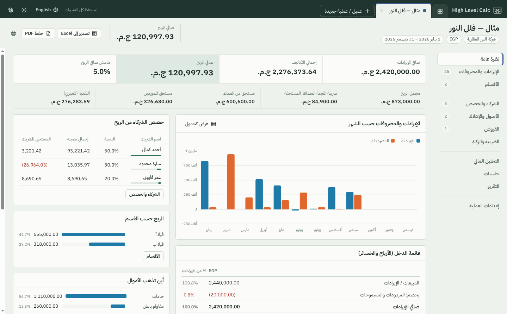
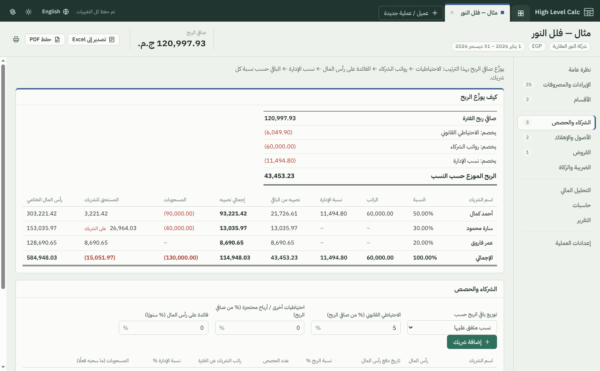
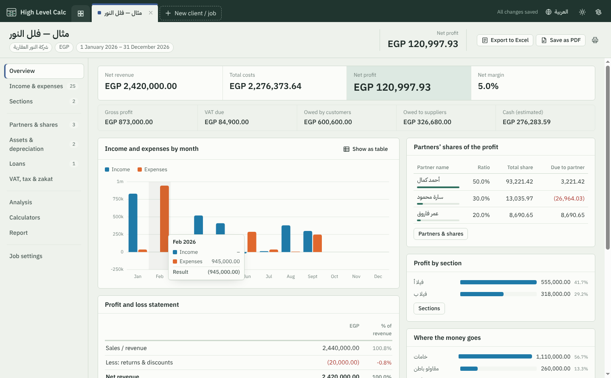

# High Level Calc

A bilingual (Arabic / English) desktop accountant. Every client or job opens in its own tab with its own ledger, sections, partners, assets, loans, taxes and reports — and every figure, from net profit to each partner's share, is worked out for you.

برنامج محاسبة لسطح المكتب باللغتين العربية والإنجليزية. كل عميل أو عملية يُفتح في تبويب مستقل له دفتر حركاته وأقسامه وشركاؤه وأصوله وقروضه وضرائبه وتقاريره — وكل الأرقام تُحسب تلقائيًا، من صافي الربح إلى نصيب كل شريك.



| | |
|---|---|
|  |  |

---

## English

### What it does

**Tabs for clients and jobs**
- One tab per client or job. Double-click a tab (or press F2) to rename it, drag tabs to reorder, middle-click or × to close.
- Closing a tab never deletes anything: reopen it from **All clients & jobs**, where you can also search, duplicate and delete (with Undo).
- Each job has its own currency (EGP, SAR, AED, KWD, USD and 17 more), accounting period, tab color and client details.

**Inside each job**

| Page | What you get |
|---|---|
| Overview | Net revenue, total costs, net profit/loss and margin; VAT due, money owed by customers / to suppliers, estimated cash; monthly income-vs-expenses chart (hover for details, or switch to a table); profit and loss statement; partners' shares; profit by section; where the money goes |
| Income & expenses | Every entry: sales, returns & discounts, direct costs, operating expenses, other income and expenses. Quantity × unit price, per-line VAT rate, paid / partly paid / unpaid, customer or supplier, invoice number. Search and filter by type, section, payment status and period |
| Sections | Split a job into parts (buildings, branches, products, phases) and get each part's revenue, direct costs, gross profit, profit and margin. Optionally spread shared costs over the sections by their share of revenue |
| Partners & shares | Net profit → legal and other reserves → partner salaries → interest on capital → management share → the rest split by agreed percentages, capital, number of shares, or capital × time in the period. Shows each partner's total share, drawings, amount due to (or owed by) the partner and closing capital account. Losses are shared too |
| Assets & depreciation | Straight line, double declining balance (switching to straight line like Excel's VDB), sum of the years' digits, or none. Depreciation is prorated by day to the period and charged to profit automatically; full schedules per asset |
| Loans | Equal installments, equal principal, or interest-only. Installment, total interest, interest inside the period (charged to profit), balance at period end, current portion; full repayment schedule |
| VAT, tax & zakat | VAT on sales and purchases, returns, amounts entered with or without VAT, VAT already paid, balance to pay or refund. Income tax: none, flat rate or progressive brackets (presets for Egypt 22.5%, KSA 20%, UAE 9% above 375,000). Zakat on net profit, on net current assets, or on a base you enter, with Hijri (2.5%) or Gregorian (2.5775%) rate and nisab |
| Analysis | 17 ratios (margins, returns on capital/equity/assets, current and quick ratios, liabilities to equity, working capital, collection rate, days to collect / pay, interest cover); financial position at period end; estimated cash flow; break-even from the job's own figures and per unit; balances by customer and supplier |
| Calculators | Percentages, add/remove VAT, pricing (margin vs markup, discount), loan installment, simple interest, compound growth with monthly additions, NPV / IRR / payback / discounted payback / profitability index, ROI and CAGR, currency conversion |
| Report | A4 financial report: P&L, profit sharing, sections, financial position, cash flow, VAT and key ratios. Print it, save it as PDF, or export the whole job to Excel |

**Language and numbers**
- Full Arabic (right-to-left) and English interfaces; switch any time from the top bar.
- Type numbers with Western (123) or Arabic-Indic (١٢٣) digits; choose which digits are shown in App settings.
- Negative amounts are shown in red, in brackets, the way accountants write them.

**Exports**
- **Excel**: one workbook per job with sheets for P&L, partners, sections, transactions, assets, loans, VAT, cash & position and settings. Totals are live formulas (`SUMIFS`, `SLN`/`VDB`/`SYD`, `PMT`, progressive tax with `SUMPRODUCT`), inputs are blue, links between sheets are green, Arabic workbooks open right-to-left. Every formula was checked by recalculating in LibreOffice: 0 errors, and every value matches the app.
- **PDF / Print**: the Report page on A4, with proper Arabic shaping.
- **Backup / Restore**: one JSON file with all clients and jobs.

**Your data**
- Saved automatically to one file on your computer (App settings → Data file shows where, with a button to open the folder). Writes are atomic, and a daily copy is kept for the last 14 days in a `backups` folder next to it.
- Set the environment variable `HLC_DATA_DIR` to keep the data somewhere else (a USB stick or a shared folder).

### Run it

You need [Node.js](https://nodejs.org) 20 or newer.

```bash
npm install
```

```bash
npm start
```

Try **Open sample job** on the first screen to see every page filled in.

### Build an installer

On Windows:

```bash
npm run dist:win
```

This makes `dist/High-Level-Calc-Setup-1.0.0.exe` (installer) and `dist/High-Level-Calc-Portable-1.0.0.exe` (runs without installing). Use `npm run dist:mac` on a Mac or `npm run dist:linux` on Linux.

Or let GitHub build all three: open **Actions → Test and build installers → Run workflow** (or push a tag like `v1.0.0`) and download the installers from the run's artifacts.

### Tests

```bash
npm test
```

28 tests cover the calculation engine (P&L, VAT, receivables/payables, every profit-sharing method, reserves, salaries, losses, depreciation methods and proration, loan schedules, tax brackets, zakat and nisab, sections and cost allocation, cash flow and financial position, break-even, NPV/IRR/payback), the translations (both languages have the same keys and placeholders, Arabic digits parse) and the Excel export.

### Project layout

```
main.js            Electron main process: window, menu, saving, PDF and Excel export
preload.js         The narrow bridge between the page and the computer
lib/xlsx-export.js Excel workbook with live formulas (ExcelJS)
src/index.html     The app page
src/styles.css     Design (light and dark)
src/js/calc.js     Calculation engine (pure functions, shared with the Excel export and tests)
src/js/i18n.js     Arabic and English text, number/money/date formatting
src/js/model.js    Data defaults, migration, sample job
src/js/store.js    Autosave and undo
src/js/app.js      Tabs, navigation, commands
src/js/views/      The pages inside a job
test/              Unit tests
```

*The figures are estimates for planning, not professional tax or financial advice — confirm final tax and zakat figures with your advisor.*

---

<div dir="rtl">

## العربية

### ماذا يقدم البرنامج

**تبويب لكل عميل أو عملية**
- تبويب مستقل لكل عميل أو عملية. انقر مرتين على التبويب (أو اضغط F2) لتغيير اسمه، واسحبه لتغيير ترتيبه، وأغلقه بزر × أو بزر الفأرة الأوسط.
- إغلاق التبويب لا يحذف شيئًا: أعد فتحه من **كل العملاء والعمليات**، وهناك أيضًا البحث والنسخ والحذف (مع إمكانية التراجع).
- لكل عملية عملتها الخاصة (جنيه مصري، ريال سعودي، درهم إماراتي، دينار كويتي، دولار و17 عملة أخرى)، وفترتها المحاسبية، ولون تبويبها، وبيانات عميلها.

**داخل كل عملية**

| الصفحة | ماذا تجد فيها |
|---|---|
| نظرة عامة | صافي الإيرادات، إجمالي التكاليف، صافي الربح أو الخسارة والهامش؛ ضريبة القيمة المضافة المستحقة، المستحق من العملاء وللموردين، النقدية التقديرية؛ رسم شهري للإيرادات والمصروفات؛ قائمة الدخل؛ حصص الشركاء؛ الربح حسب القسم؛ أين تذهب الأموال |
| الإيرادات والمصروفات | كل الحركات: مبيعات، مردودات ومسموحات، تكاليف مباشرة، مصروفات تشغيلية، إيرادات ومصروفات أخرى. الكمية × سعر الوحدة، نسبة ضريبة لكل سطر، مسدد / مسدد جزئيًا / غير مسدد، العميل أو المورد، رقم الفاتورة. بحث وتصفية حسب النوع والقسم والسداد والفترة |
| الأقسام | قسّم العملية إلى أجزاء (عمارات، فروع، منتجات، مراحل) واعرف إيراد كل جزء وتكاليفه المباشرة ومجمل ربحه وصافي ربحه وهامشه، مع إمكانية توزيع التكاليف المشتركة على الأقسام حسب نصيب كل قسم من الإيرادات |
| الشركاء والحصص | صافي الربح ← الاحتياطي القانوني والاحتياطيات الأخرى ← رواتب الشركاء ← الفائدة على رأس المال ← نسبة الإدارة ← الباقي يوزع حسب النسب المتفق عليها أو رأس المال أو عدد الحصص أو رأس المال × المدة. يظهر إجمالي نصيب كل شريك ومسحوباته والمستحق له أو عليه ورصيد رأس ماله الختامي. والخسارة توزع أيضًا |
| الأصول والإهلاك | القسط الثابت، القسط المتناقص المضاعف (مع التحول للقسط الثابت مثل دالة VDB في Excel)، مجموع أرقام السنوات، أو بدون إهلاك. إهلاك الفترة يُحسب بالتناسب اليومي ويُخصم من الربح تلقائيًا، مع جدول كامل لكل أصل |
| القروض | أقساط متساوية، أصل متساوٍ، أو فوائد فقط والأصل في النهاية. القسط وإجمالي الفوائد وفوائد الفترة (تُخصم من الربح) والرصيد في نهاية الفترة والجزء المستحق خلال سنة، مع جدول السداد كاملًا |
| الضريبة والزكاة | ضريبة القيمة المضافة على المبيعات والمشتريات والمردودات، المبالغ شاملة أو غير شاملة الضريبة، المسدد بالفعل، والمتبقي للسداد أو الاسترداد. ضريبة الدخل: بدون، نسبة ثابتة، أو شرائح تصاعدية (إعدادات جاهزة لمصر 22.5% والسعودية 20% والإمارات 9% فوق 375,000). الزكاة على صافي الربح أو صافي الأصول المتداولة أو وعاء تدخله، بنسبة السنة الهجرية (2.5%) أو الميلادية (2.5775%) مع النصاب |
| التحليل المالي | 17 نسبة مالية (الهوامش، العائد على رأس المال وحقوق الملكية والأصول، نسبة التداول والسيولة السريعة، الالتزامات إلى حقوق الملكية، رأس المال العامل، نسبة التحصيل، أيام التحصيل والسداد، تغطية الفوائد)؛ المركز المالي في نهاية الفترة؛ التدفقات النقدية التقديرية؛ نقطة التعادل من أرقام العملية وبالوحدة؛ أرصدة العملاء والموردين |
| حاسبات | النسب المئوية، إضافة واستخراج الضريبة، التسعير (الهامش والإضافة والخصم)، قسط القرض، الفائدة البسيطة، النمو المركب مع إضافات دورية، صافي القيمة الحالية ومعدل العائد الداخلي وفترة الاسترداد العادية والمخصومة ومؤشر الربحية، العائد على الاستثمار ومعدل النمو السنوي، تحويل العملات |
| التقرير | تقرير مالي على مقاس A4: قائمة الدخل، توزيع الأرباح، الأقسام، المركز المالي، التدفقات النقدية، الضريبة وأهم النسب. اطبعه أو احفظه PDF أو صدّر العملية كاملة إلى Excel |

**اللغة والأرقام**
- واجهة عربية كاملة (من اليمين لليسار) وواجهة إنجليزية؛ بدّل بينهما في أي وقت من الشريط العلوي.
- اكتب الأرقام بالأرقام الغربية (123) أو العربية (١٢٣)، واختر شكل الأرقام المعروضة من إعدادات البرنامج.
- المبالغ السالبة تظهر باللون الأحمر بين قوسين كما يكتبها المحاسبون.

**التصدير**
- **Excel**: ملف لكل عملية يحتوي أوراق قائمة الدخل والشركاء والأقسام والحركات والأصول والقروض والضريبة والنقدية والإعدادات. الإجماليات معادلات حية، والمدخلات باللون الأزرق، والروابط بين الأوراق باللون الأخضر، والملفات العربية تُفتح من اليمين لليسار. تمت مراجعة كل المعادلات بإعادة الحساب في LibreOffice: صفر أخطاء، وكل القيم مطابقة للبرنامج.
- **PDF / طباعة**: صفحة التقرير على A4 مع تشكيل عربي صحيح.
- **نسخ احتياطي واستعادة**: ملف JSON واحد بكل العملاء والعمليات.

**بياناتك**
- تُحفظ تلقائيًا في ملف واحد على جهازك (إعدادات البرنامج ← ملف البيانات يوضح مكانه مع زر لفتح المجلد). الحفظ آمن ضد انقطاع الكهرباء، وتُحفظ نسخة يومية لآخر 14 يومًا في مجلد `backups` بجواره.
- لحفظ البيانات في مكان آخر (فلاشة أو مجلد مشترك) اضبط متغير البيئة `HLC_DATA_DIR`.

### التشغيل

تحتاج [Node.js](https://nodejs.org) الإصدار 20 أو أحدث، ثم نفّذ الأمرين:

</div>

```bash
npm install
```

```bash
npm start
```

<div dir="rtl">

جرّب **فتح عملية مثال** من الشاشة الأولى لترى كل الصفحات ممتلئة بالأرقام.

### بناء ملف التثبيت

على ويندوز:

</div>

```bash
npm run dist:win
```

<div dir="rtl">

سينتج `dist/High-Level-Calc-Setup-1.0.0.exe` (ملف تثبيت) و`dist/High-Level-Calc-Portable-1.0.0.exe` (يعمل بدون تثبيت). أو اجعل GitHub يبني النسخ الثلاث (ويندوز وماك ولينكس): افتح **Actions ← Test and build installers ← Run workflow** ثم حمّل الملفات من نتائج التشغيل.

*الأرقام تقديرات للتخطيط وليست استشارة ضريبية أو مالية مهنية — راجع أرقام الضريبة والزكاة النهائية مع مستشارك.*

</div>
